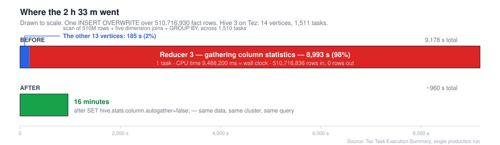
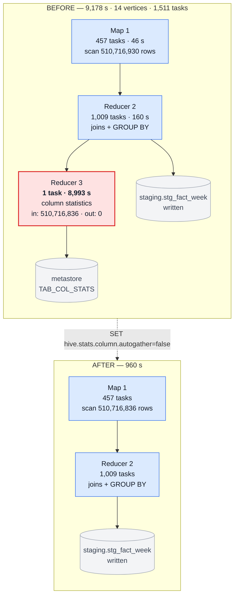
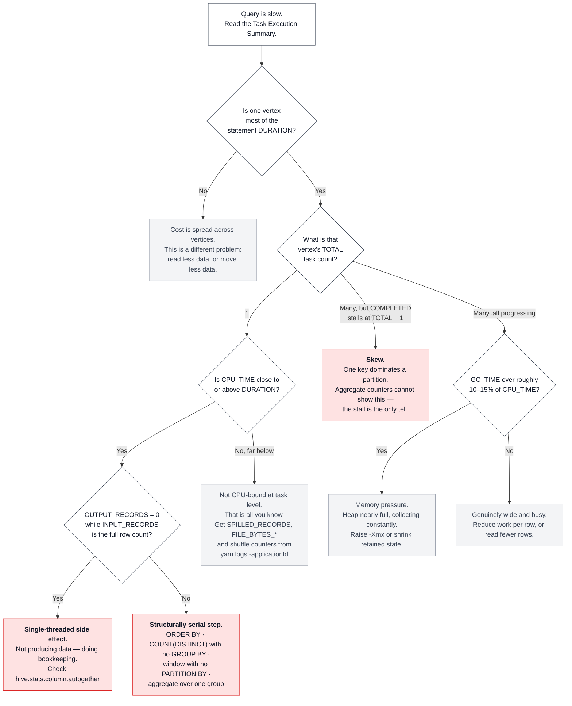

A nightly `INSERT OVERWRITE` that aggregates 510 million fact rows started taking
two and a half hours. Nothing about the data had changed. The cluster was not
busy. Adding containers did nothing.

The scan, the five dimension joins and the `GROUP BY` took about three minutes
between them. The remaining 2 hours and 30 minutes was spent by a single task,
computing statistics that nothing in the pipeline would ever read.

This post is about how to spot that shape of problem, because the usual advice —
raise parallelism, add containers, tune reducer counts — is actively useless
against it. When one step in your query structurally cannot be split across
machines, it sets the floor on your runtime no matter how much hardware you
point at the rest.

## The symptom

The statement is unremarkable. Aggregate a large fact table, join five
dimensions to resolve surrogate keys to names, group, write to a staging table:

```sql
INSERT OVERWRITE TABLE staging.stg_fact_week
SELECT   t.planning_month_key,
         l.country_name,
         c.channel_name,
         v.version_name,
         i.product_name,
         t.season_name,
         SUM(CAST(s.units      AS DECIMAL(38,10))) AS units,
         SUM(CAST(s.net_amount AS DECIMAL(38,10))) AS net_amount
         -- ... eleven more SUM(CAST(... AS DECIMAL(38,10))) measures
FROM       warehouse.fact_style_week s
INNER JOIN (SELECT DISTINCT version_key, version_name FROM warehouse.dim_version) v
ON         v.version_key = s.version_key
INNER JOIN (SELECT DISTINCT location_key, country_name FROM warehouse.dim_location) l
ON         l.location_key = s.location_key
-- ... three more dimension joins
GROUP BY   t.planning_month_key, l.country_name, c.channel_name,
           v.version_name, i.product_name, t.season_name;
```

Hive on Tez, HDP 3. Fourteen vertices, 1,511 tasks. Here is what the console
printed when it finally finished:

```
Query Execution Summary
----------------------------------------------------------------------------------------------
OPERATION                            DURATION
----------------------------------------------------------------------------------------------
Compile Query                           1.12s
Prepare Plan                            5.44s
Get Query Coordinator (AM)              0.00s
Submit Plan                             1.03s
Start DAG                               1.45s
Run DAG                              9178.25s
----------------------------------------------------------------------------------------------

Task Execution Summary
----------------------------------------------------------------------------------------------
  VERTICES      DURATION(ms)   CPU_TIME(ms)    GC_TIME(ms)   INPUT_RECORDS   OUTPUT_RECORDS
----------------------------------------------------------------------------------------------
     Map 1          46452.00      4,062,180        112,814     510,716,930    1,238,133,241
    Map 10           3704.00         15,760            165           3,977               96
    Map 13           3704.00         16,670            171           4,019            1,112
     Map 4           4228.00          9,690            119               1                1
     Map 6           4228.00         17,640            197              92               92
     Map 8          54882.00        197,640          1,255       4,731,457        4,731,457
 Reducer 11          2631.00          3,450             33              96               50
 Reducer 12          6335.00          3,500             41               2                1
 Reducer 14           524.00          1,390              0           1,112              575
 Reducer 2         159653.00     23,837,720        608,015     515,448,916    1,427,044,597
 Reducer 3        8993294.00      9,488,200        104,670     510,716,836                0
 Reducer 5              0.00            390              0               1                1
 Reducer 7           1049.00          1,270              0              92               92
 Reducer 9          56399.00        282,510          7,773       4,731,457        4,731,457
----------------------------------------------------------------------------------------------
```

Scan that `DURATION` column. Thirteen of the fourteen vertices account for about
185 seconds between them. `Reducer 3` alone is 8,993,294 ms — **98% of the
entire DAG.**

The two vertices doing the real work are `Map 1`, scanning 510,716,930 fact rows
in 46 seconds across 457 tasks, and `Reducer 2`, handling the joins and the
`GROUP BY` in 160 seconds across 1,009 tasks. Look at `Reducer 2`'s CPU time
while you are there: 23,837,720 ms, which is 23,838 CPU-seconds compressed into
a 160-second window. That is the work of roughly 149 cores running at once. The
cluster was not short of parallelism.

Then all of it waited on one task for two and a half hours.



## The three facts that identify it

Before knowing anything about what `Reducer 3` was for, three things in that row
tell you almost everything.

**It ran as one task.** The progress output makes this unmissable. Here is the
DAG at 99%, where it sat for the overwhelming majority of those two and a half
hours:

```
        VERTICES      MODE        STATUS  TOTAL  COMPLETED  RUNNING  PENDING  FAILED  KILLED
----------------------------------------------------------------------------------------------
Map 4 .......... container     SUCCEEDED      1          1        0        0       0       0
Reducer 5 ...... container     SUCCEEDED      2          2        0        0       0       0
Map 6 .......... container     SUCCEEDED      2          2        0        0       0       0
Reducer 7 ...... container     SUCCEEDED      2          2        0        0       0       0
Map 10 ......... container     SUCCEEDED      2          2        0        0       0       0
Reducer 11 ..... container     SUCCEEDED      2          2        0        0       0       0
Reducer 12 ..... container     SUCCEEDED      1          1        0        0       0       0
Map 1 .......... container     SUCCEEDED    457        457        0        0       0       0
Map 8 .......... container     SUCCEEDED     10         10        0        0       0       0
Reducer 9 ...... container     SUCCEEDED     18         18        0        0       0       0
Map 13 ......... container     SUCCEEDED      2          2        0        0       0       0
Reducer 14 ..... container     SUCCEEDED      2          2        0        0       0       0
Reducer 2 ...... container     SUCCEEDED   1009       1009        0        0       0       0
Reducer 3        container       RUNNING      1          0        1        0       0       0
----------------------------------------------------------------------------------------------
VERTICES: 13/14  [=========================>>-] 99%   ELAPSED TIME: 9177.78 s
```

Thirteen vertices `SUCCEEDED`. 1,510 of 1,511 tasks finished. One task
`RUNNING`, with `TOTAL 1` — and no setting changes that number, because it is a
property of the plan rather than of the tuning.

If you have ever watched a Hive job sit at 99% and assumed it was nearly done,
this is what that looks like from the inside.

**Its CPU time equals its wall-clock time.** 9,488,200 ms of CPU against
8,993,294 ms of duration, a ratio slightly above 1.0 because JIT and GC threads
contribute. For a single task that means its one core was pinned for essentially
the entire run. It was not waiting on disk, not waiting on network, not waiting
on anything. It was computing.

This is the one direction the CPU ratio can be trusted in. A *high* ratio is
conclusive, because CPU time cannot accumulate while a thread is blocked. A
*low* ratio tells you much less than people assume — but that is a different
post.

**It produced zero output rows.** It consumed all 510,716,836 rows and emitted
nothing. Whatever it was doing, it was not transforming data on the way to the
table. The table was already written. This vertex was a side effect.

And its GC time was 104,670 ms against 9,488,200 ms of CPU — 1.1%. Not memory
pressure. Nothing was thrashing. It was simply a very large amount of
single-threaded work.

## What that vertex was doing

It was gathering column statistics.

In Hive 3, `hive.stats.column.autogather` defaults to `true`. The default was
flipped from `false` in [HIVE-13567][h13567], whose patch diff makes it
explicit:

```diff
- HIVESTATSCOLAUTOGATHER("hive.stats.column.autogather", false,
+ HIVESTATSCOLAUTOGATHER("hive.stats.column.autogather", true,
      "A flag to gather column statistics automatically."),
```

The feature itself came from [HIVE-11160][h11160]: "INSERT OVERWRITE will
automatically create new column stats. INSERT INTO will automatically merge new
column stats with existing ones."

That is a genuinely useful feature. Before Hive 3 you had to run `ANALYZE TABLE
... COMPUTE STATISTICS FOR COLUMNS` yourself, and most people never did, so the
cost-based optimiser ran blind. Hive 3 made it automatic.

The cost is that it happens *inside your DAG*. Huawei's MapReduce Service
documentation states the consequence plainly:

> When column statistics collection is enabled, Reduce operations must be
> performed for aggregation. For insert tasks without the Reduce phase, Reduce
> operations will be performed to collect statistics.
>
> — [Optimizing Multi-Table Queries with Hive CBO][huawei]

So enabling column statistics *adds a reduce stage* to a write that would not
otherwise have one. In my DAG that stage was `Reducer 3`, and it received every
one of the 510 million rows.

## Why it cannot be parallelised

Column statistics are per-column aggregates over the whole dataset: number of
distinct values, number of nulls, min, max, average length. They end up in the
metastore's `TAB_COL_STATS` table as one row per column, as the
[Hive StatsDev design doc][statsdev] describes.

One row per column means the computation has to converge to a single result.
Hive's plan therefore ends with a single-task vertex that merges everything into
the final set of values to publish. You can see the intent in HIVE-11160's own
subtask list, which includes "Merge stats task and column stats task into a
single task".

That is the structural part. A vertex whose job is to produce one answer for the
whole table has nothing to split across machines. And because this particular
vertex received all 510 million rows rather than pre-aggregated partials, the
whole per-row cost landed in one thread.

This is Amdahl's law with a concrete face. If 2% of your work is parallel and 98%
is serial, buying twice the cluster improves your runtime by roughly 1%. The
question that matters is never "how do I parallelise this harder" — it is
**"which step here cannot be parallelised at all, and can I delete it?"**



## The fix

One line, in the session that runs the write:

```sql
SET hive.stats.column.autogather=false;
```

Result: the statement went from **2 hours 33 minutes to 16 minutes**. A sibling
script doing the same thing against a smaller fact table went from 22 minutes to
5. The whole pipeline that wraps them now finishes in about 21 minutes.

Nothing else changed. No extra containers, no reducer tuning, no query rewrite,
no new hardware.

## When you should *not* do this

This is the part most performance posts skip, and it matters more than the fix.

Column statistics are not waste in general. They are what the cost-based
optimiser uses to choose join orders and decide whether a table is small enough
to broadcast. On a table that gets queried repeatedly, having them is usually
worth far more than the one-off cost of computing them. [HDP's own performance
guidance][hdp3stats] calls column statistics "critical" to making CBO
functional, and it is right.

Disabling autogather is correct when **nothing will ever read the statistics you
are paying to produce.** In my case the tables were staging: written once by this
script, exported once to object storage, then dropped. No optimiser ever saw
them. Every millisecond spent on their statistics was pure loss.

So the test is not "are statistics expensive" — they are. It is:

- Is this table read by queries whose plans the optimiser needs to choose? Keep
  autogather on, or run `ANALYZE` on a schedule.
- Is this table write-once, consume-once, throwaway? Turn it off.
- Is it read often but written in a narrow batch window you need to protect?
  Turn autogather off for the write, and run `ANALYZE TABLE ... COMPUTE
  STATISTICS FOR COLUMNS` separately, outside the window.

That third option is the one most people want and almost nobody sets up. The
statistics still get computed; they just stop sitting on the critical path of
your load.

Note also that **basic** statistics are a different thing and should stay on.
`hive.stats.autogather` covers row counts, file counts and total size, and per
the StatsDev doc those are accumulated by the file-sink operator *as it writes* —
distributed across every writer task, effectively free. Those row counts are also
what you want for verifying a load. I left them enabled.

## How to find this in your own query



Concretely, three steps.

**Watch the progress output, not just the total time.** The tell is a vertex
whose `COMPLETED` count stalls while `TOTAL` is 1, or stalls at `TOTAL - 1`. Both
mean a single task is holding the DAG open — the first structurally, the second
usually from skew.

**Read the Task Execution Summary.** Turn it on if your session does not print
it:

```sql
SET hive.tez.exec.print.summary=true;
```

Then look for a vertex where `DURATION` is a large fraction of the statement,
and compare `CPU_TIME` against it. CPU time at or above duration means a pinned
core doing real work. Far below it means something else, and you need the spill
and shuffle counters from `yarn logs -applicationId <id>` to say what.

**Check the settings rather than trusting a document.** This matters: HDP 3's
documentation says Hive "generates table statistics, but not column statistics,
which you must generate manually" — which contradicts the upstream Hive 3.0.0
default established in HIVE-13567. Vendor defaults diverge from upstream, and
documentation goes stale. The only authority is your own session:

```sql
SET hive.stats.column.autogather;
SET hive.stats.autogather;
SET hive.compute.query.using.stats;
```

## The general shape

Column statistics are one instance. The pattern recurs, and the diagnostic is
always the same — find the vertex with one task:

- `ORDER BY` forces a single reducer by definition, because a global ordering
  cannot be produced in parallel. Use `SORT BY` plus `DISTRIBUTE BY` when you
  need ordering within partitions rather than across the whole result.
- `COUNT(DISTINCT col)` with no `GROUP BY` funnels every value through one
  reducer to deduplicate.
- A window function with no `PARTITION BY` has one logical partition, so one
  task.
- An aggregation over a single group — `SELECT SUM(x) FROM t` — converges to one
  value.
- A `LIMIT` on an unordered query still has to collect candidates centrally.

In each case the fix is not more parallelism. It is either removing the
requirement, or accepting it and making sure the single-threaded step sees as few
rows as possible.

## What is measured here, and what is not

Both console blocks above are verbatim from the logs of one production run, with
only the table and column identifiers in the SQL changed. The vertex counters,
the task counts, the 9,178.25 second DAG, the 99% progress snapshot and the
16-minute result after the change are all measured, not reconstructed. I would
still encourage you not to trust the *general* claims without checking them
against your own cluster, because version differences here are real.

Two caveats worth knowing. The Task Execution Summary has had reporting bugs —
[HIVE-28309][h28309] has `DURATION` always printing zero, and
[HIVE-16436][h16436] reports incorrect durations for map vertices. If your
numbers look impossible, check whether your version is affected before drawing
conclusions. And my explanation of *why* the stats vertex is single-task is drawn
from how the feature is designed and documented, not from instrumenting Hive's
planner. The observation that it ran as one task, consumed every row and emitted
none is measured. The reasoning about why is mechanism, and the fix does not
depend on it.

## Sources

- [HIVE-13567 — Enable auto-gather column stats by default][h13567] (fix version 3.0.0; the patch diff shows the default flip)
- [HIVE-11160 — Auto-gather column stats][h11160] (the feature, and its subtask list)
- [Apache Hive — StatsDev design doc][statsdev] (what is stored where, and how basic stats are gathered in the file sink)
- [Apache Hive — Column Statistics in Hive][colstats] (design doc for column statistics)
- [HDP 3.0 — Statistics generation and viewing commands][hdp3stats]
- [Huawei MRS — Optimizing Multi-Table Queries with Hive CBO][huawei] (states that column stats collection adds a reduce stage)
- [HIVE-28309][h28309], [HIVE-16436][h16436] — known Task Execution Summary reporting bugs

[h13567]: https://issues.apache.org/jira/browse/HIVE-13567
[h11160]: https://issues.apache.org/jira/browse/HIVE-11160
[statsdev]: https://hive.apache.org/development/desingdocs/statsdev/
[colstats]: https://hive.apache.org/development/designdocs/column-statistics-in-hive/
[hdp3stats]: https://docs-archive.cloudera.com/HDPDocuments/HDP3/HDP-3.0.0/performance-tuning/content/hive_statistics_generation_and_viewing_commands.html
[huawei]: https://support.huaweicloud.com/intl/en-us/cmpntguide-lts-mrs/mrs_01_0983.html
[h28309]: https://issues.apache.org/jira/browse/HIVE-28309
[h16436]: https://issues.apache.org/jira/browse/HIVE-16436
